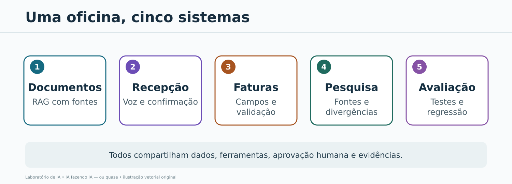
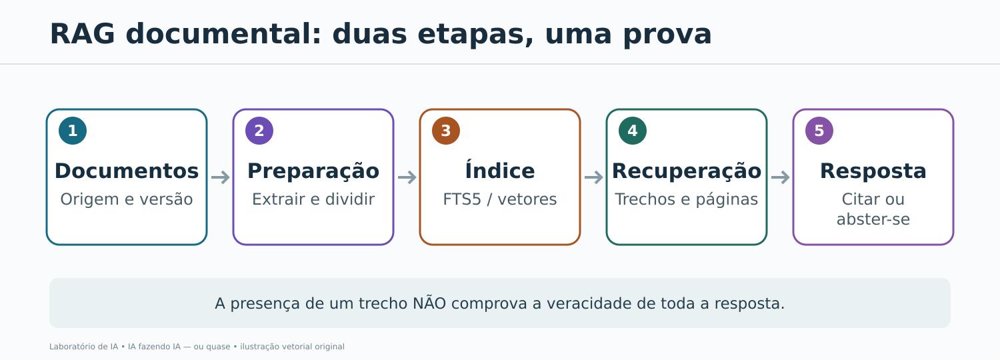
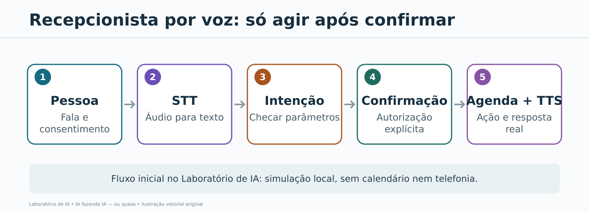
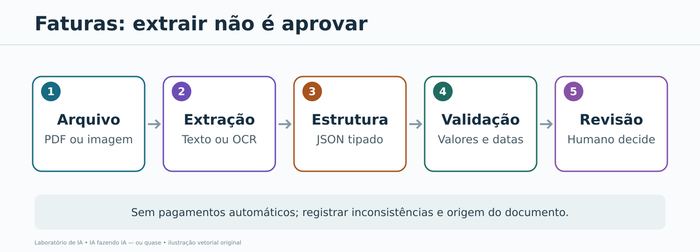
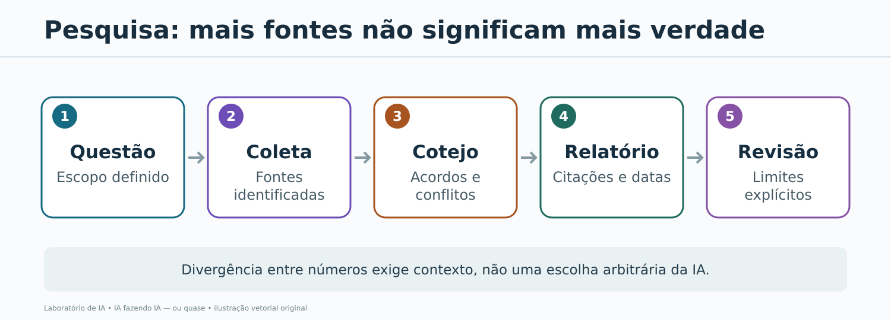
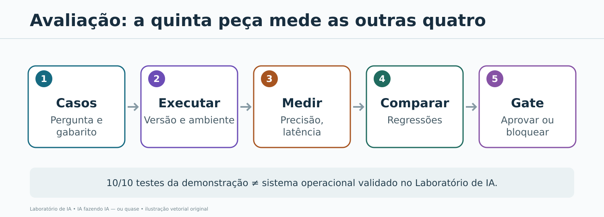

# Cinco sistemas de IA — da demonstração à oficina verificável

**Complemento técnico do livro _IA fazendo IA — ou quase_.** Edição pública, sem inventários, credenciais ou configuração de laboratório privado.

**Vídeo didático:** https://youtu.be/P2hft-BH0qA

# 1. Resumo executivo

O vídeo de origem (2min27s, formato vertical) afirma que conectar uma interface a uma API de LLM não basta para construir aplicações de IA úteis. Ele organiza o aprendizado em **cinco projetos**: (1) assistente de documentos, (2) recepcionista por voz, (3) processamento de faturas, (4) pesquisa com múltiplas fontes e (5) avaliação de sistemas. O final insiste em dados, recuperação, ferramentas, validação e testes, mais importantes que uma demonstração bonita.

**Nossa adaptação:** construir uma única oficina no laboratório de IA com componentes reaproveitáveis, checkpoints e provas de cada etapa. Não é uma tradução literal do narrador. Não representa endosso do autor original e não reproduz seus desenhos ou personagens.

**Escopo público:** este material apresenta uma arquitetura reproduzível e ensaios com dados artificiais. Não descreve equipamentos, endereços, configurações, armazenamento ou serviços particulares. A instalação em uma máquina física permanece pendente.

# 2. Auditoria de conceitos do vídeo

| Proposta | O que o vídeo ilustra | O que a implementação realmente exige |
|---|---|---|
| Documentos com RAG | carregar páginas, recuperar trechos e citar origem | ingestão, extração, indexação, controle de versão/permissões, métricas de recuperação e verificação de citações |
| Recepção por voz | chamada → texto → LLM → calendário → fala | reconhecimento de fala, interpretação, tool calling, integração com agenda, confirmação, tratamento de falhas e consentimento |
| Processar faturas | documento → campos estruturados | extração de texto/OCR quando necessário, esquema, validação de datas/valores, revisão humana e trilha de auditoria |
| Pesquisa | consultas a várias fontes, relatório e conflitos | proveniência, data e autoria, recuperação múltipla, comparação verificável, indicação de desacordo e revisão |
| Plataforma de avaliação | perguntas de teste, modelos, pontuação por versão | conjunto de teste rotulado, métricas distintas, custo/latência, regresão, rastreabilidade e gates de aceite |

Os ícones de ferramentas no vídeo são **exemplos**, não uma lista de requisitos. RAG não obriga usar banco vetorial: nosso LAB-RAG-01 utiliza SQLite/FTS5 como caminho inicial. A recuperação de trechos não valida automaticamente a resposta final. Uma avaliação com poucas questões não prova qualidade geral.

# 3. Arquitetura comum proposta



**Componentes compartilhados:** arquivos autorizados e suas versões; adaptadores de entrada (texto, PDF, áudio); buscador lexical e, se justificar, vetorial; modelo local opcional; conectores de ferramentas isolados; esquema estruturado de saída; avaliação regressiva; logs sem segredos; aprovação humana para ações com efeito.

Os requisitos de processamento e armazenamento dependem dos modelos escolhidos. Antes de executar componentes pesados, medir CPU, RAM, armazenamento e, quando houver, aceleradores; evitar execução simultânea sem aferição de capacidade.

# 4. Etapa 0 — verificar a infraestrutura, sem alterar o sistema

Em uma instalação própria, execute os comandos abaixo somente com autorização e registre o resultado localmente. **Não publique a saída dos comandos**:

```bash
python3 --version

# Ferramentas específicas de GPU são opcionais e devem ser executadas apenas quando aplicáveis
python3 lab.py diagnostico
```

Registrar localmente data, requisitos mínimos e estado de execução, sem anexar logs privados ao repositório. **Gate G0:** sistema operacional e acesso autorizados, armazenamento confiável e nenhum procedimento de instalação que modifique drivers sem plano de reversão. Com discos reaproveitados, o SMART e testes de superfície têm precedência sobre RAID. Não expor Ollama, bases e interfaces na internet pública sem autenticação e isolamento.

# 5. Etapa 1 — assistente documental auditável



1. **Selecionar fontes autorizadas:** começar com documentos fictícios; depois, manuais próprios. Cada arquivo recebe nome, versão e origem.
2. **Extrair texto:** preferir texto selecionável; OCR só para imagens/scans. Conferir tabelas, paginação, símbolos elétricos e unidades.
3. **Particionar e indexar:** trechos com identificador estável, referência de página e metadados. **Não** misturar versões de um mesmo manual sem registrá-las.
4. **Recuperar:** começar com SQLite FTS5/BM25, reaproveitando `LAB-RAG-01`. Vetores e rerankers são aprimoramentos a justificar por testes.
5. **Responder ou abster-se:** o LLM só recebe material autorizado; caso falte evidência, informar que não encontrou. Citação é vinculada ao trecho recuperado, nunca fabricada.
6. **Medir:** hit@k, cobertura de fontes, precisão de citações e rejeição de perguntas sem respaldo em base de referência.

**Exemplo da oficina:** buscar informações de diagnóstico no manual fictício do computador didático. **Não** considerar o texto de teste um circuito real nem recomendar reparos sem documentação técnica e medições físicas.

# 6. Etapa 2 — recepcionista por voz, em modo seguro



1. Entrada de áudio e aviso/consentimento, quando cabíveis.
2. Reconhecimento de fala (STT), por exemplo `faster-whisper`, após verificar dependências, CUDA/driver e desempenho.
3. Extração de intenção e parâmetros; confirmar nomes, dia, horário e objetivo.
4. Consulta de disponibilidade em calendário autorizado, se houver integração; diferenciar consulta de reserva.
5. Solicitar confirmação do usuário **antes de criar eventos** e impedir duplicidade por chave idempotente.
6. Síntese de fala (TTS) e confirmação do resultado real, não uma fala inventada.

**Primeiro gate:** diálogo inteiramente simulado, sem telefone, sem calendar API e sem gravações persistidas. O comando `python3 lab.py voz "Quero marcar uma visita"` não cria eventos.

# 7. Etapa 3 — processador de faturas com revisão



1. Receber um PDF fictício (ou arquivo-texto do protótipo).
2. Extrair texto direto; OCR apenas quando o PDF for imagem e houver necessidade.
3. Produzir campos tipados: fornecedor, número, data, valor total, imposto, moeda.
4. Validar formato, existência, valores não negativos, consistência de campos e possíveis duplicidades.
5. Marcar incertezas e solicitar revisão humana antes de registrar, enviar ou pagar qualquer valor.
6. Registrar evidência do arquivo e da decisão, sem expor dados sensíveis.

O protótipo usa uma fatura **fictícia** e somente verifica estrutura; não reconhece layouts arbitrários, não executa OCR e **não** se conecta ao sistema financeiro.

# 8. Etapa 4 — pesquisa em várias fontes



1. Definir pergunta e escopo antes da busca.
2. Buscar documentos e referências com identidade, data, autoria e URL quando existirem.
3. Normalizar afirmações por tema, preservando trechos e evitando confundir opinião com evidência.
4. Identificar acordos, divergências, versões e limitações de cada fonte.
5. Gerar relatório com links, passagens relevantes e lacunas a investigar.
6. Encerrar com parecer provisório e pontos de auditoria humana.

O ensaio local apenas compara números de duas fontes fictícias (30 e 60 dias). **Números diferentes não são prova de contradição contextual**; podem ser versões ou casos distintos.

# 9. Etapa 5 — plataforma de avaliação (transversal)



Uma avaliação confiável separa pelo menos quatro medidas:

| Medida | Pergunta | Evidência |
|---|---|---|
| Recuperação hit@k | A fonte esperada apareceu entre as k primeiras? | conjunto de perguntas com fonte rotulada |
| Qualidade factual | A afirmação foi sustentada pela fonte? | comparação e inspeção de trechos |
| Segurança de ações | Foi pedido consentimento? Houve efeitos não autorizados? | logs de simulação e testes de falha |
| Operação | Quanto tempo, CPU/RAM/VRAM e custo consumiu? | telemetria reproduzível por versão |

**Amostra funcional já criada:** três questões sintéticas, com `hit@2 = 1,0` nesta sessão, e dez testes de unidade passando no núcleo local. Isto **não prova desempenho da IA**: é apenas um teste da implementação lexical e dos dados artificiais. O próprio ensaio precisa crescer com casos negativos, conflitos e documentos difíceis.

# 10. Plano de implementação por gates

| Gate | Entrega | Critério de saída | Situação |
|---|---|---|---|
| G0 | linha de base do laboratório de IA | inventário e acesso remoto reproduzível | pendente: computador real |
| G1 | protótipo Python | testes locais e dados fictícios | **10/10 PASS no ensaio de autoria (dados fictícios)** |
| G2 | RAG integrado | reutilizar LAB-RAG-01, citar e abster | pendente de integração |
| G3 | pesquisa multi-fonte | identificar divergências com origem | parcial: demo lexical |
| G4 | leitura de faturas | extrair, validar, revisar | parcial: arquivo de exemplo |
| G5 | fluxo de voz | STT → confirmação → TTS | parcial: simulação de intenção |
| G6 | QA contínuo | avaliação antes de cada versão | parcial: conjunto inicial sintético |

**Ordem recomendada:** G0 → G1 → G2 + G6 → G3 → G4 → G5. É prudente medir primeiro modelos leves e evitar cinco serviços pesados simultâneos.

# 11. Comandos de execução da demonstração

No repositório, entre em `laboratorio/cinco-sistemas-ia/` e rode:

```bash
python3 -m unittest discover -s testes -v
python3 lab.py diagnostico
python3 lab.py documentos "Qual o prazo de reembolso?"
python3 lab.py voz "Quero marcar uma visita"
python3 lab.py fatura
python3 lab.py pesquisa
python3 lab.py avaliar --saida saida/avaliacao.json
```

Todos os comandos são locais. Não é necessário instalar bibliotecas externas para rodar os exemplos. Veja o README do projeto para os critérios de conferência.

# 12. Destino editorial e reuso

**Complemento público:** `complementos/cinco-sistemas-ia-laboratório de IA/` conterá este caderno, seis SVGs editáveis e links cruzados com RAG, ferramentas e avaliações, seguindo o padrão existente no GitHub.

**Código:** `laboratorio/laboratório de IA-cinco-sistemas/` poderá conter os exemplos e testes de dados fictícios, sem resultados privados, tokens e binários pesados.

**Vídeo didático:** versão em português publicada no YouTube: https://youtu.be/P2hft-BH0qA. O repositório contém o link, não uma cópia do MP4. Não subir MP4 diretamente ao repositório.

# 13. Referências para consulta e auditoria

- Vídeo original fornecido pelo usuário, `VID-20261120-WA0022.mp4`, duração 2m27s. A análise foi feita por amostras sequenciais de imagens e legendas visíveis. **Não foi produzida transcrição verificada palavra a palavra da locução original.**
- Repositório do livro e catálogo: https://github.com/phtomas/livro-ia-fazendo-ia-ou-quase
- Laboratório RAG existente: https://github.com/phtomas/livro-ia-fazendo-ia-ou-quase/tree/main/laboratorio/rag-pratico
- Ollama Linux: https://ollama.com/download/linux
- Docling: https://docling-project.github.io/docling/getting_started/installation/
- Faster-Whisper: https://github.com/SYSTRAN/faster-whisper
- Promptfoo e avaliações: https://www.promptfoo.dev/docs/getting-started/

> Nada é “funcionou” sem prova. Simplicidade é força. Isole e meça antes de adivinhar. Não reinvente a roda. E cresçam juntos.
