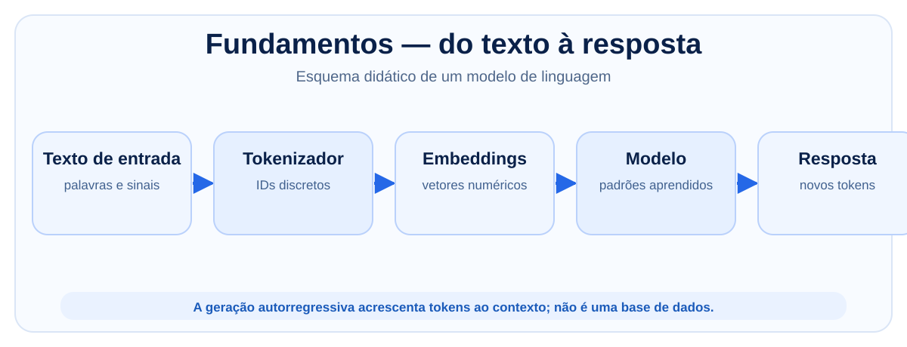
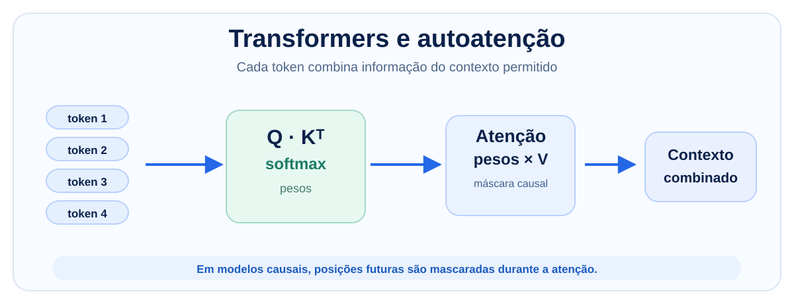
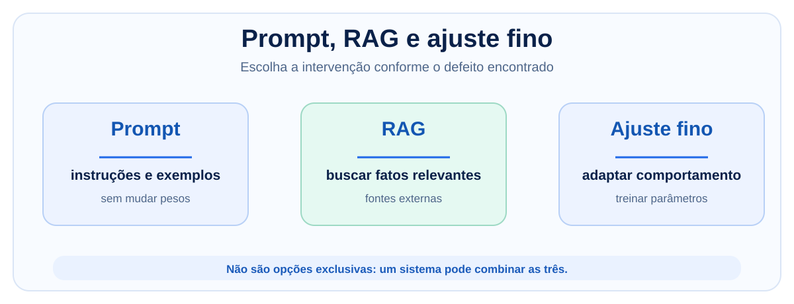
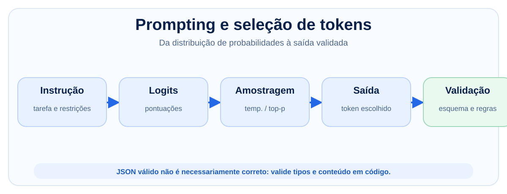
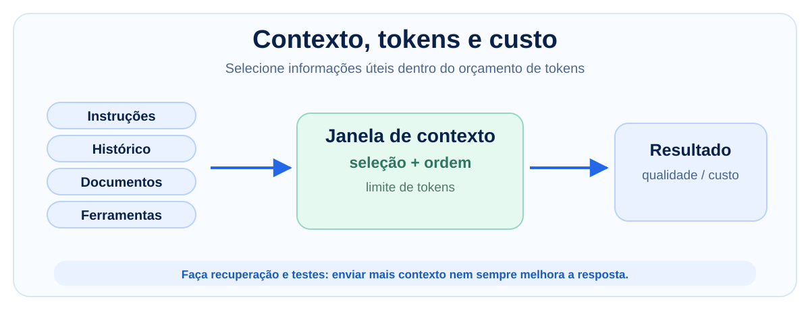
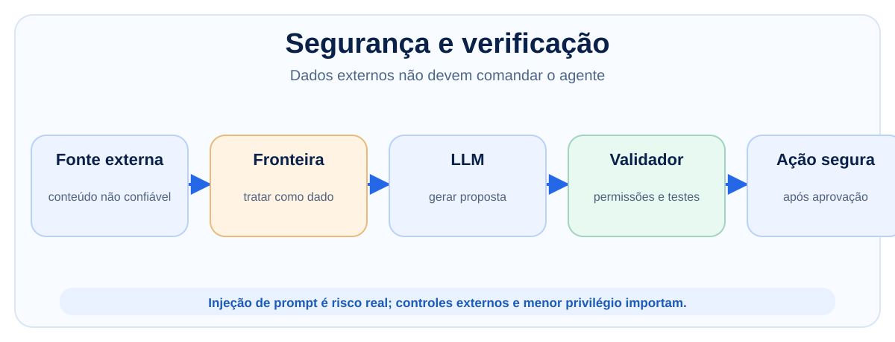
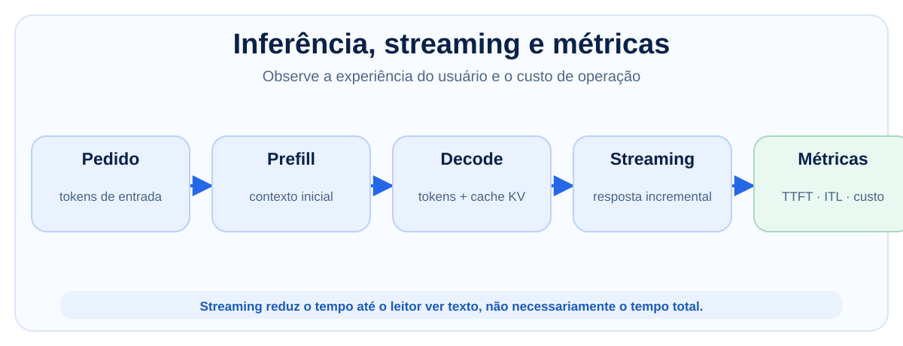

# 40 perguntas para entender os LLMs

**Material complementar do livro _IA fazendo IA — ou quase_ — José Albuquerque.**

Esta adaptação editorial em português reorganiza conceitos gerais a partir de referências técnicas. Não reproduz as artes recebidas, nem o livro integral. Os conceitos técnicos são complementares e estão sujeitos a mudanças nas APIs. Versão de 16/11/2026.

[Ver página visual](index.html) · [Referências](REFERENCIAS.md)

## 01. Fundamentos

O vocabulário mínimo para entender um modelo de linguagem.

### 1. O que é um LLM?

É um modelo de linguagem de grande porte, geralmente baseado em uma rede neural treinada com grandes conjuntos de dados. Muitos LLMs atuais aprendem a prever tokens e, após treinamento adicional, podem gerar e transformar texto.

*Nota técnica:* Predição de tokens explica uma família importante de modelos, mas não é definição exclusiva de toda arquitetura.

### 2. O que é um token?

É uma unidade usada pelo tokenizador: pode corresponder a parte de uma palavra, palavra, espaço, pontuação ou outro elemento, dependendo do modelo.

*Nota técnica:* Número de tokens não corresponde diretamente ao número de palavras.

### 3. O que é a janela de contexto?

É o limite de informação tokenizada que o modelo consegue processar em uma interação, sujeito às regras de entrada e saída de cada API.

*Nota técnica:* Caber na janela não garante que todos os detalhes sejam recuperados de maneira confiável.

### 4. O que significa geração autorregressiva?

É gerar um token por vez, condicionando a próxima previsão aos tokens anteriores. Implementações modernas reutilizam estados de atenção, como o cache KV.

*Nota técnica:* O texto anterior não precisa ser tokenizado e recalculado integralmente a cada passo.

### 5. Pré-treinamento e pós-treinamento são diferentes?

Sim. O pré-treinamento constrói capacidades gerais a partir de dados; o pós-treinamento pode alinhar o modelo a instruções, preferências e tarefas.

*Nota técnica:* As técnicas variam: SFT, preferência e reforço são exemplos, não etapas obrigatórias em todos os modelos.

### 6. O que é um parâmetro?

É um valor aprendido durante o treinamento, como um peso de uma camada neural. Mais parâmetros podem ampliar a capacidade, mas não garantem um modelo melhor.

*Nota técnica:* Arquitetura, dados, otimização e avaliação importam tanto quanto a contagem de parâmetros.

## 02. Transformers e atenção

Como um modelo combina representações ao longo da sequência.

### 7. O que é autoatenção?

É um mecanismo que combina informações de diferentes posições de uma sequência, usando pesos aprendidos que dependem do contexto.

*Nota técnica:* Em decodificadores causais, cada posição não pode acessar tokens futuros.

### 8. O que são queries, keys e values?

Consultas (Q) são comparadas a chaves (K) para calcular a atenção. Os pesos resultantes combinam vetores de valor (V).

*Nota técnica:* Q, K e V são projeções aprendidas, não campos fornecidos manualmente.

### 9. Por que múltiplas cabeças de atenção?

Diferentes cabeças podem modelar relações distintas, como dependências sintáticas e semânticas, em paralelo.

*Nota técnica:* Nem toda cabeça tem uma interpretação humana única; algumas são redundantes.

### 10. Como o modelo representa a posição dos tokens?

Usa informação posicional, por exemplo codificações incorporadas aos vetores ou métodos rotacionais como RoPE.

*Nota técnica:* A implementação depende da arquitetura.

### 11. Por que Transformers paralelizam o treinamento?

Durante o treinamento, várias posições da sequência podem ser processadas em paralelo, aproveitando operações matriciais.

*Nota técnica:* A geração autorregressiva normalmente continua sequencial token a token.

### 12. A atenção sempre custa tempo quadrático?

A atenção densa convencional calcula interações entre pares de posições e tem custo aritmético quadrático no comprimento da sequência.

*Nota técnica:* Kernels otimizados, atenção esparsa ou outras arquiteturas mudam memória, desempenho e complexidade prática.

## 03. Treinamento e ajuste fino

Adaptação do modelo sem confundir aprendizado com consulta documental.

### 13. O que é fine-tuning?

É continuar o treinamento de um modelo já existente para ajustar capacidades, comportamento ou formato em uma tarefa.

*Nota técnica:* Pode usar diferentes tipos e quantidades de dados, inclusive técnicas sem rótulos tradicionais.

### 14. O que é LoRA?

Low-Rank Adaptation é uma técnica de ajuste eficiente que aprende atualizações de matrizes de baixo posto enquanto mantém grande parte dos pesos-base congelada.

*Nota técnica:* Reduz parâmetros treináveis e muitas vezes o uso de memória; não elimina necessidade de avaliação.

### 15. Quando escolher prompt, RAG ou fine-tuning?

Comece com bons prompts e testes. Use RAG quando faltarem fatos atualizáveis ou privados; considere fine-tuning quando faltar consistência de comportamento.

*Nota técnica:* As três abordagens podem ser combinadas.

### 16. O que é RLHF?

É o uso de feedback humano para orientar a otimização do modelo, frequentemente por preferências entre respostas.

*Nota técnica:* A forma clássica usa modelo de recompensa e otimização por reforço, mas existem variantes.

### 17. O que é DPO?

Direct Preference Optimization ajusta o modelo usando pares de respostas preferidas e rejeitadas, sem exigir um modelo de recompensa separado no treinamento clássico de DPO.

*Nota técnica:* Qualidade e representatividade dos pares continuam decisivas.

### 18. O que é esquecimento catastrófico?

É a perda de competências previamente aprendidas após treinamento adicional muito especializado.

*Nota técnica:* Mitigação inclui dados diversificados, parâmetros de treino conservadores e testes de regressão.

## 04. Prompts e decodificação

Instruções, probabilidade e formatos de resposta.

### 19. Zero-shot e few-shot: qual a diferença?

Zero-shot descreve a tarefa sem exemplos específicos; few-shot acrescenta alguns exemplos do comportamento desejado.

*Nota técnica:* Exemplos ruins também podem induzir erros.

### 20. O que é chain-of-thought prompting?

É uma família de técnicas que usa etapas intermediárias ou exemplos de resolução para tarefas complexas.

*Nota técnica:* Não garante correção; para sistemas modernos, solicite resultados verificáveis e justificativas concisas, conforme a API.

### 21. O que é temperatura?

É um ajuste da distribuição de probabilidades de saída. Valores maiores tendem a aumentar variedade; menores, a concentração em opções prováveis.

*Nota técnica:* Temperatura zero não garante saídas idênticas em todas as execuções.

### 22. Qual a diferença entre top-k e top-p?

Top-k limita a escolha a um número fixo de tokens candidatos. Top-p seleciona um conjunto cuja probabilidade acumulada alcança um limiar.

*Nota técnica:* Nem todos os modelos ou APIs oferecem ambos os parâmetros.

### 23. O que é saída estruturada?

É produzir uma representação legível por software, como JSON, eventualmente guiada por esquema.

*Nota técnica:* Produzir JSON válido não garante aderência a um esquema nem correção semântica; valide no código.

### 24. O que são instruções de sistema?

São instruções de alta prioridade que orientam o papel e os limites do assistente.

*Nota técnica:* Algumas plataformas distinguem papéis system e developer. A hierarquia específica depende do provedor.

## 05. Contexto, tokens e custo

O orçamento informacional e computacional de cada pedido.

### 25. Por que os tokenizadores importam?

O mesmo texto pode ocupar quantidades distintas de tokens entre modelos, idiomas e tipos de conteúdo.

*Nota técnica:* Isso afeta a janela de contexto e a cobrança em provedores que faturam por token.

### 26. O que é lost in the middle?

É a dificuldade observada em alguns modelos de recuperar detalhes colocados no meio de contextos extensos.

*Nota técnica:* É um efeito experimental contextual, não uma lei para todos os modelos.

### 27. O que é prompt caching?

É reutilizar processamento associado a prefixos repetidos, quando o serviço e a requisição permitem.

*Nota técnica:* Regras de elegibilidade, descontos e duração do cache dependem do provedor.

### 28. O que determina o custo de uso?

Modelo, tokens de entrada e saída, quantidade de chamadas, ferramentas, retransmissões e infraestrutura.

*Nota técnica:* Preços e políticas mudam; saída frequentemente é mais cara por token, mas isso não é universal.

### 29. O que é engenharia de contexto?

É selecionar, ordenar e limitar instruções, histórico, documentos recuperados e resultados de ferramentas para entregar ao modelo o contexto relevante.

*Nota técnica:* Contexto maior não significa necessariamente contexto melhor.

### 30. Como trabalhar com entradas maiores que a janela?

Divida, indexe e recupere trechos relevantes; use resumos hierárquicos ou etapas independentes quando for apropriado.

*Nota técnica:* Preserve rastreabilidade das fontes e teste a perda de detalhes nos resumos.

## 06. Alucinações e segurança

O que fazer quando respostas plausíveis não são suficientes.

### 31. O que é uma alucinação?

É uma informação produzida com aparência de confiança, mas falsa, inventada ou sem evidência adequada.

*Nota técnica:* Fluência não equivale a veracidade.

### 32. Como reduzir alucinações?

Use fontes confiáveis, recuperação relevante, exigência de evidência, checagem automática e avaliações com casos conhecidos.

*Nota técnica:* Diminuir temperatura pode alterar variabilidade, mas não garante fatos verdadeiros.

### 33. O que é prompt injection?

É inserir instruções adversariais em conteúdo de menor confiança para alterar o comportamento de um sistema de IA.

*Nota técnica:* Documentos e resultados de ferramentas são dados, não autoridades para comandar o agente.

### 34. O que é jailbreaking?

É tentar contornar salvaguardas para obter comportamentos que deveriam ser bloqueados.

*Nota técnica:* Pode ocorrer por técnicas relacionadas à injeção, mas os termos não são sinônimos perfeitos.

### 35. O que é um guardrail?

É um controle de segurança ou conformidade, no modelo ou em componentes externos, aplicado a entradas, saídas e ações.

*Nota técnica:* Validação em código, permissões mínimas e revisão humana são importantes para ações de maior risco.

## 07. Inferência e implantação

Medição e operação de um serviço com LLM.

### 36. API hospedada ou modelo próprio?

A API hospedada reduz o esforço operacional; hospedar localmente aumenta controle, mas exige hardware, segurança e manutenção.

*Nota técnica:* Compare privacidade, qualidade, custo total, desempenho e equipe antes de escolher.

### 37. O que é quantização?

É representar pesos e/ou ativações em precisão reduzida, por exemplo 8 ou 4 bits, para diminuir uso de memória.

*Nota técnica:* Pode melhorar velocidade em hardware compatível, mas nem sempre acelera e pode afetar qualidade.

### 38. O que afeta a latência?

Modelo, tamanho do prompt, quantidade de tokens gerados, lote, concorrência, rede, ferramentas e plataforma de inferência.

*Nota técnica:* TTFT e ITL são métricas observadas; não são causas independentes.

### 39. O que é streaming?

É transmitir partes da resposta enquanto são produzidas, permitindo leitura antecipada.

*Nota técnica:* Reduz a latência percebida, mas não necessariamente o tempo total da tarefa.

### 40. Como avaliar antes da implantação?

Teste casos representativos e adversariais, tarefas de segurança, respostas de referência, custo, latência e falhas de regressão.

*Nota técnica:* Mantenha avaliação e monitoramento após o lançamento.

---

Fontes técnicas: Vaswani et al. (2017); FlashAttention (Dao et al., 2022); Hugging Face PEFT e Transformers; DPO (Rafailov et al., 2023); documentação OpenAI (Structured Outputs, Prompt Caching, avaliações); OWASP LLM Top 10; Liu et al. (Lost in the Middle).
